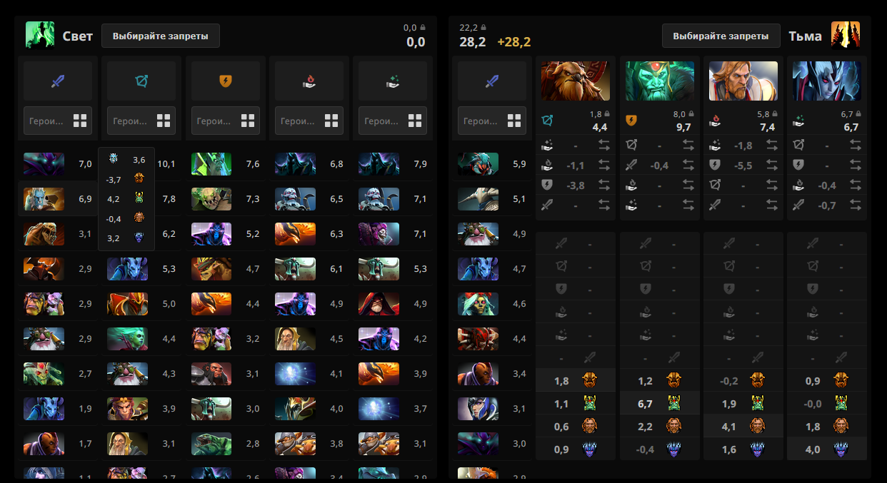
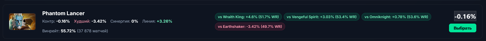
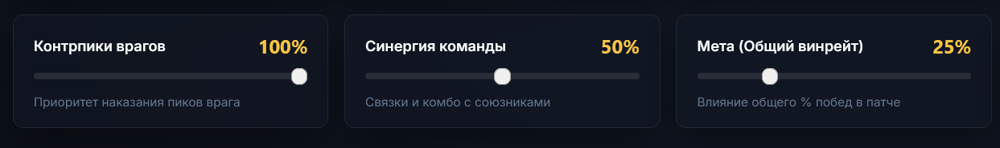
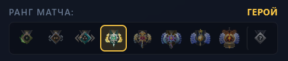
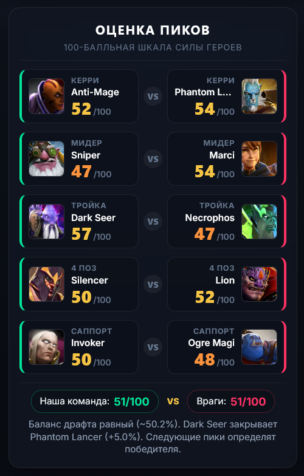
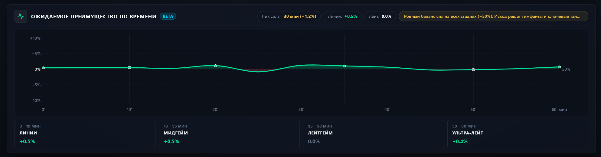
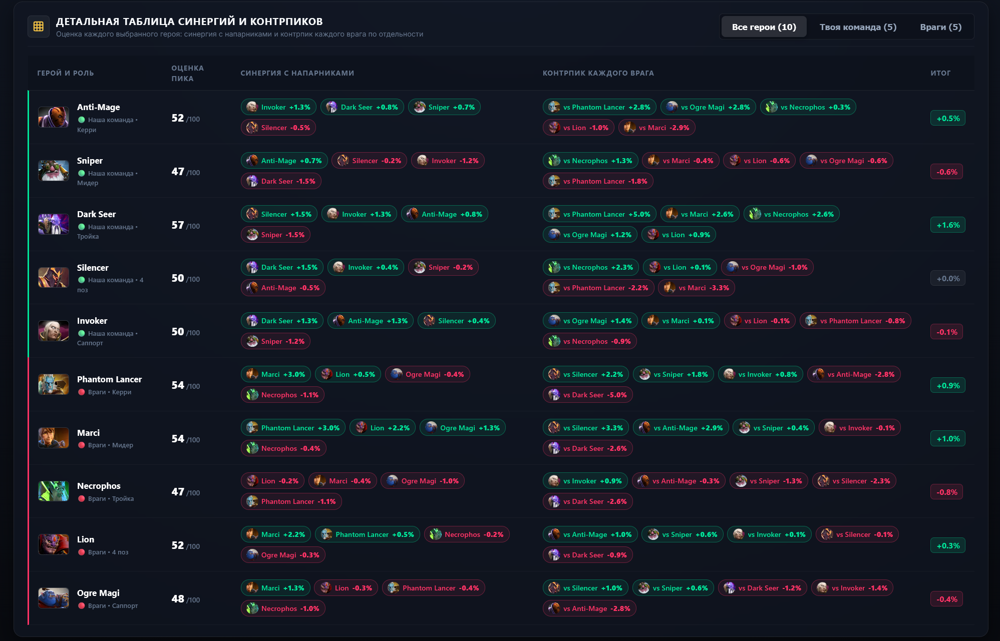

# StratzDrafter

Советник по драфту в Dota 2 на базе Stratz API. В отличие от стандартных драфтеров, делает упор на жесткие контрпики, драфтит сразу на 5 ролей и не заставляет играть только по мете.

Онлайн-сайт: https://programnoe-obespechenie.duckdns.org/

---

## В чем разница со Stratz ROSH

Обычный драфтер часто советует взять героя с высоким общим винрейтом, которого в конкретном матче закроют вражеские пики.

| Stratz ROSH (советует героя под контрпик) | StratzDrafter (учитывает закрытие пика) |
| :---: | :---: |
|  |  |

---

## Возможности

### 1. Настройка весов рекомендаций
Можно менять важность факторов под себя: контрпики врагов, синергия с союзниками и сила героя в текущей мете. Если синергия на вашем ранге не решает, ее влияние можно просто убрать.



### 2. Выбор ранга матча
Статистика винрейтов и матчапов подтягивается под конкретный брекет (от рекрутов до имморталов).



### 3. Оценка шанса на победу и разбор угроз
Показывает расчетный шанс победы драфта, ключевые контрпики и главные угрозы со стороны вражеской команды.



### 4. График силы по времени (0–60 мин)
Показывает ожидаемое преимущество команд на разных минутах матча по реальной статистике Stratz.



### 5. Таблица синергий и контрпиков по каждому игроку
Показывает детальный разбор матчапов каждого героя против каждого врага и связки с союзниками.



### 6. Дополнительно
- Сетка на 5 позиций: подбор героев сразу для всей команды в одном окне.
- Поддержка офф-меты: включение нестандартных ролей (керри Фурион, мид Пудж и т.д.).
- Поиск по сленгу: поддержка русскоязычных названий («фура», «гуля», «папич», «ам»).
- Быстрый отклик: локальный кэш матрицы 127x127 героев без ожидания ответов от API.

---

## Запуск

### Windows
- Установка для друзей: запустить `setup.bat` (установит зависимости и создаст ярлык).
- Обычный запуск: `run.bat` (откроет `http://localhost:5000`).

### Сервер (Ubuntu VPS)
```bash
git clone https://github.com/smeshar/StratzDrafter.git
cd StratzDrafter
bash deploy.sh
```

Обновление сервера:
```bash
bash update.sh
```